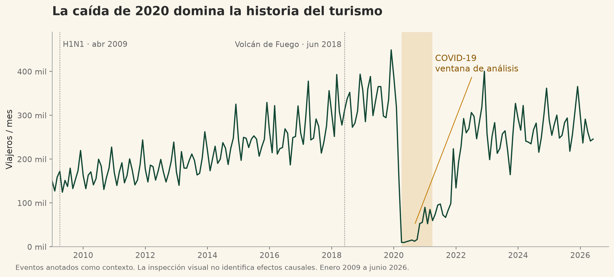
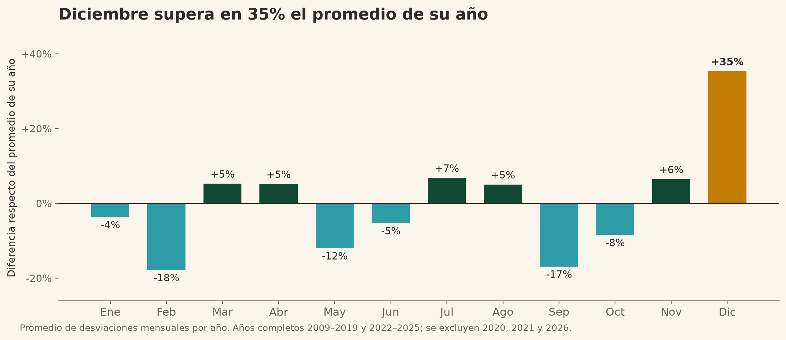
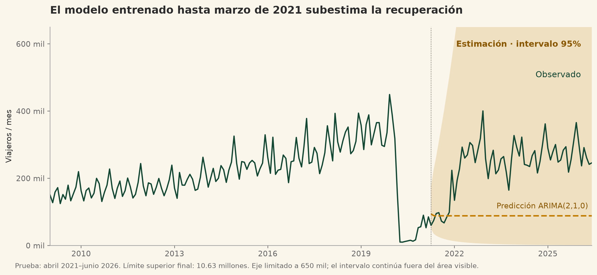
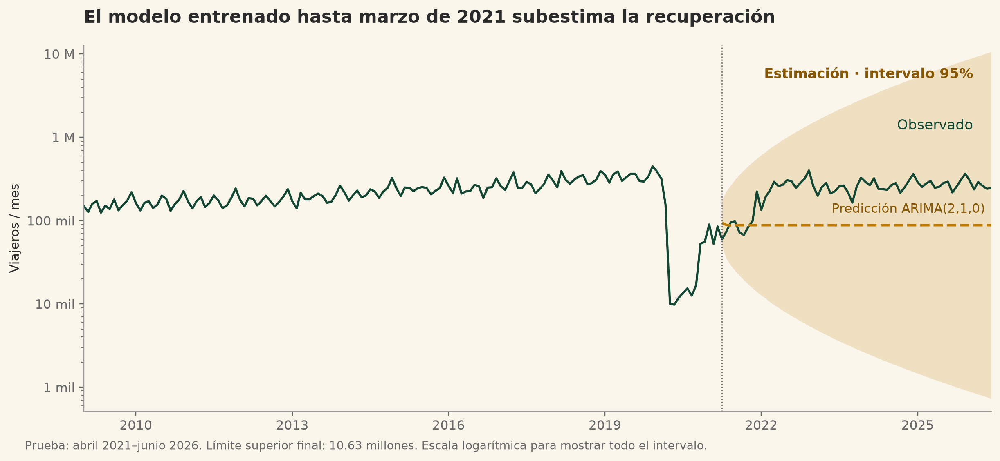

# Decisiones de visualización del turismo en Guatemala

Laboratorio 9 de Data Science · Universidad del Valle de Guatemala
Ihan Marroquin 23108 · Diego Patzan 23525
Catedrático Ing. Erick Marroquin · Entrega prevista 18 de octubre de 2026

La infografía comunica cómo cambió el ingreso mensual de viajeros entre enero de 2009 y junio de 2026 y qué límites tienen los modelos entrenados antes de la recuperación. La conclusión central es que el flujo se recuperó del desplome de 2020, pero el pronóstico del Lab 1 quedó persistentemente por debajo de lo observado. Por eso proponemos decisiones operativas apoyadas en la estacionalidad y una actualización del modelo antes de usarlo para presupuestos.

## 1 Audiencia y recorrido de lectura

Nos dirigimos a una persona del INGUAT que planifica campañas, personal y capacidad. Tiene pocos minutos para leer y no necesita conocer la formulación estadística. Usamos un titular informativo, cifras grandes, gráficos con unidades y recomendaciones vinculadas a evidencia. Los términos técnicos que no caben en el lienzo se definen en este documento.

| Bloque del enunciado | Representación final y propósito |
| --- | --- |
| Titular y cifras | Titular sobre recuperación y pronóstico; cuatro indicadores dan escala al problema. |
| Panorama histórico | Línea mensual con eventos de contexto y banda del período usado para medir la caída. |
| Estacionalidad vías y mercados | Barras por mes, rankings horizontales y matriz de seis series. |
| Modelos y pronóstico | Tabla de ocho algoritmos sobre el mismo conjunto de prueba y predicción con intervalo del 95%. |
| Hallazgos y recomendaciones | Tres acciones concretas para campañas, segmentación y actualización predictiva. |

El recorrido de arriba hacia abajo va del contexto a la decisión. El titular y los indicadores tienen mayor tamaño; la historia precede al calendario; la comparación estadística precede a las recomendaciones. Los cinco bloques del enunciado están presentes: el titular no lleva número y los otros cuatro se identifican del 01 al 04.

## 2 Alcance de los datos

Usamos la Base de Migración 2009-2026 INGUAT/IGM facilitada en el curso. Conservamos Turista y Excursionista, como en el Lab 1; excluimos Crucerista y Viajero para mantener el mismo alcance. Son registros agregados de ingresos de viajeros, no personas únicas. El período tiene 210 observaciones mensuales; 2026 solo incluye enero a junio. Las cifras no se presentan como una nueva publicación oficial de las instituciones.

La variable País cambia de nivel de detalle después de 2023, según la advertencia del análisis previo. Guatemala se conserva como categoría registrada en la base y no se interpreta automáticamente como turismo interno, nacionalidad ni mercado internacional independiente. Esta limitación impide convertir el ranking acumulado en una recomendación de inversión por país sin validación adicional.

---

## 3 Historia y estacionalidad

La línea es apropiada para observaciones mensuales ordenadas: conserva la secuencia, muestra crecimiento, caída y recuperación sin introducir agregaciones anuales engañosas. El eje inicia en cero. Las anotaciones de H1N1 y Volcán de Fuego ubican hechos que plantea el análisis previo; no constituyen pruebas de impacto o ausencia de impacto. Sustituimos la afirmación absoluta de las imágenes recibidas por una lectura descriptiva.

Figura 1. La banda abril 2020-marzo 2021 es una ventana de medición, no la duración completa de la pandemia.

Para el calendario calculamos 100 × (viajeros del mes / promedio mensual de su año - 1), y luego promediamos por mes del calendario dando el mismo peso a cada año. Excluimos 2020 y 2021 por la ruptura y 2026 porque está incompleto. Quedan 15 años completos: 2009-2019 y 2022-2025. Las barras parten de cero y separan valores positivos, negativos y diciembre mediante color y etiquetas numéricas.

Figura 2. Diciembre está 35.34% sobre el promedio anual; febrero -17.83% y septiembre -16.89%. Valores del lienzo redondeados.

El patrón coincide con una mayor movilidad al cierre de año; la base no permite demostrar que aguinaldo o fiestas sean su causa. Tampoco atribuimos los pequeños aumentos de marzo, abril o julio a Semana Santa o Bono 14 sin identificar fechas y contrastes adicionales. La estacionalidad descriptiva de años completos y la fuerza STL de entrenamiento responden preguntas distintas y no deben confundirse.

---

## 4 Cifras vías mercados y comparación de series

| Indicador | Cálculo y resultado |
| --- | --- |
| Promedio mensual | Suma de los 210 meses / 210 = 222,437.68; se muestra 222,438. |
| Máximo mensual | 449,114.07 en diciembre de 2019; se muestra 449,114. |
| Caída en pandemia | 1 - promedio abr 2020-mar 2021 / promedio ene-dic 2019 = 89.6958%; se muestra 89.7%. |
| La Aurora acumulado | 18,989,984.61 en el período; se muestra 18.99 millones. |

Los rankings usan barras horizontales con origen cero porque comparan categorías sin orden natural y nombres largos. La vía terrestre acumula 27.59 millones, la aérea 19.02 millones y la marítima 100,241 ingresos comparables. El volumen marítimo excluye Crucerista y por tanto no representa todo el turismo de cruceros. El Salvador, Guatemala y Estados Unidos son los tres mayores valores acumulados de País: 14.08, 13.87 y 6.97 millones, con las restricciones ya descritas.

### Definiciones de las cuatro medidas

Estacionalidad: max(0, 1 - Var(residuo) / Var(estacional + residuo)) de una STL robusta sobre log(1+y), período 12, usando solo entrenamiento. Crecimiento: pendiente de una recta sobre log(1+y) entre enero de 2022 y junio de 2026; es una medida mensual en escala logarítmica, no un porcentaje directo. Volatilidad: desviación estándar poblacional de las primeras diferencias de log(1+y) de toda la serie. Caída: reducción del promedio abril 2020-marzo 2021 frente al promedio de 2019.

| Serie | Fuerza STL | Pendiente | Volatilidad | Caída |
| --- | --- | --- | --- | --- |
| América del Centro | 0.004 | -0.0014 | 0.301 | 89.8% |
| América del Norte | 0.000 | +0.0115 | 0.907 | 87.4% |
| Europa | 0.075 | +0.0082 | 0.741 | 94.1% |
| La Aurora | 0.057 | -0.0001 | 0.425 | 84.2% |
| Valle Nuevo | 0.000 | +0.0049 | 0.692 | 96.3% |
| San Cristóbal | 0.255 | +0.0116 | 0.580 | 95.1% |

La tabla visual permite responder las cuatro preguntas sin combinar magnitudes incompatibles en un único índice. El ocre resalta el mayor valor dentro de regiones y dentro de fronteras. Entre regiones, Europa presenta mayor fuerza estacional y caída; América del Norte, mayor crecimiento y volatilidad. Entre fronteras, San Cristóbal presenta mayor estacionalidad y crecimiento; Valle Nuevo, mayor volatilidad y caída. En las seis series, los máximos globales son San Cristóbal para estacionalidad y crecimiento, América del Norte para volatilidad y Valle Nuevo para caída.

### Recomendaciones derivadas de la evidencia

Primero, preparar capacidad para diciembre y probar campañas en febrero y septiembre con metas medibles de demanda. Segundo, segmentar las decisiones por región y frontera: las fuertes caídas históricas de Europa y Valle Nuevo justifican revisar su recuperación con datos actuales, antes de reasignar presupuesto. Tercero, reentrenar y validar por ventanas móviles con datos recientes; el corte de entrenamiento en pandemia limita el pronóstico. Los resultados históricos orientan estas revisiones y no prueban por sí solos dónde invertir hoy.

---

## 5 Comparación de modelos

Conservamos la división temporal del Lab 1: enero 2009-marzo 2021 para entrenamiento (147 meses) y abril 2021-junio 2026 para prueba (63 meses). MAE es el promedio del error absoluto; RMSE penaliza con más fuerza los errores grandes. Ambos se expresan en viajeros y deben compararse entre algoritmos de la misma serie y horizonte. No se usan para concluir que una región es más predecible que otra con diferente volumen.

| Modelo total mensual | MAE viajeros | RMSE viajeros |
| --- | --- | --- |
| ARIMA(2,1,0) | 156,261.29 | 170,915.02 |
| ARIMA(0,1,2) | 156,513.34 | 171,210.54 |
| ARIMA(2,1,2) | 165,701.09 | 180,457.50 |
| Exponencial simple | 165,372.54 | 180,598.23 |
| Holt-Winters aditivo | 172,351.72 | 184,529.72 |
| Naive estacional | 207,321.64 | 219,663.87 |
| SARIMA(2,1,2)×(1,0,1)₁₂ | 210,905.81 | 225,573.47 |
| Respaldo aditivo* | 239,790.76 | 252,070.38 |

El ganador guardado del total es ARIMA(2,1,0), por menor RMSE, con MAE como segundo criterio de orden. Los valores de esta tabla se leen del CSV original del Lab 1. El modelo rotulado como respaldo aditivo usa una regresión Ridge con tendencia, cambios de pendiente y términos de Fourier; no es Prophet oficial. SARIMA y las variantes ARIMA se incluyen tal como fueron evaluadas. AIC y BIC no se usan para ordenar familias diferentes ni series diferentes; están disponibles en las tablas fuente.

### Ganadores originales de las siete series

| Serie | Modelo ganador | MAE | RMSE |
| --- | --- | --- | --- |
| Total mensual | ARIMA(2,1,0) | 156,261 | 170,915 |
| América del Centro | ARIMA(2,1,0) | 105,942 | 117,900 |
| América del Norte | ARIMA(2,1,0) | 29,651 | 34,120 |
| Europa | Exponencial simple | 9,571 | 10,978 |
| La Aurora | ARIMA(0,1,2) | 35,684 | 40,874 |
| Valle Nuevo | Holt-Winters aditivo | 32,214 | 34,625 |
| San Cristóbal | Exponencial simple | 20,483 | 23,092 |

Ningún método gana en todas las series. El Lab 1 guardado elige ARIMA(2,1,0) para total, América del Centro y América del Norte; ARIMA(0,1,2) para La Aurora; exponencial simple para Europa y San Cristóbal; Holt-Winters aditivo para Valle Nuevo. Estas filas corrigen el avance, que utilizó candidatos y cifras de otra comparación. La versión entregada no mezcla esos resultados.

### Alcance de esta elección

El conjunto de prueba se usa para comparar modelos y elegir el ganador histórico. Eso no equivale a una evaluación final independiente de un modelo ya elegido. Además, casi todo el horizonte de prueba pertenece a la recuperación y el entrenamiento termina en un nivel muy bajo. Antes de recomendar un pronóstico operativo corresponde validar por ventanas móviles y reservar una evaluación futura, en lugar de extrapolar esta tabla hasta diciembre de 2026.

---

## 6 Predicción e incertidumbre

Reajustamos únicamente el ganador del total con la especificación original: SARIMAX sobre log(1+y), orden (2,1,0), sin tendencia y sin imponer estacionariedad ni invertibilidad. El ajuste convergió. La validación reproduce MAE 156,261.29 y RMSE 170,915.02, con diferencias inferiores a 0.00001 viajeros frente al CSV conservado.

Figura 3. Serie observada, predicción del ganador del Lab 1 e intervalo del 95% rotulado Estimación. La banda excede el eje visible.

Los límites se calculan en escala logarítmica y se transforman con exp(x)-1, con piso cero. La curva puntual mantiene la convención del Lab 1: exp(media logarítmica)-1; corresponde a una mediana condicional, no a la media aritmética con ajuste de sesgo. El primer intervalo es aproximadamente [49,562, 177,069]; el límite superior final alcanza 10.63 millones.

Figura 4. Vista complementaria en escala logarítmica que muestra la amplitud completa del intervalo; no se usa para comparar alturas como proporciones lineales.

El intervalo es predictivo y condicionado a los supuestos del modelo; en el lienzo se conserva el rótulo 95% que pide el enunciado. Los 63 valores observados caen dentro de él, pero una cobertura de 100% con amplitud extrema no demuestra una buena predicción. El intervalo no incorpora explícitamente incertidumbre sobre cambios estructurales. El eje de la infografía se limita a 650 mil para leer la serie; una nota declara el recorte y el límite completo, que se muestra aquí. Todo el gráfico es retrospectivo sobre prueba, no una proyección posterior a junio de 2026.

---

## 7 Decisiones de diseño y teoría del color

Conservamos la dirección visual propuesta en el avance: una familia sans serif, fondo crema, línea histórica verde y un acento cálido para dirigir la atención. Verde y turquesa forman una relación cercana en el círculo cromático; el ocre introduce contraste de temperatura. Las asociaciones con naturaleza, agua y maíz son decisiones de diseño contextual y no propiedades estadísticas de los datos.

| Color | Función semántica |
| --- | --- |
| Verde selva #124734 | Serie observada, barras positivas y jerarquía visual. |
| Turquesa #2E9CA6 | Desviaciones mensuales negativas; se acompañan de signo y etiqueta. |
| Ocre #C27C00 | Pico de diciembre, banda histórica, ganador y predicción. El texto pequeño usa un tono más oscuro de la misma familia. |
| Crema #FAF6EC y gris #2B2B2B | Fondo neutro y texto principal, respectivamente. |

El color no es el único canal: observación y predicción se diferencian con línea continua y discontinua; los valores negativos llevan signo; los ganadores están en negrita; las bandas están rotuladas. Evitamos afirmar accesibilidad completa para todos los tipos de daltonismo sin pruebas. El acento de texto se oscurece para mejorar el contraste sobre crema. Se evita depender del turquesa para leer cifras pequeñas.

Las barras parten de cero, se rotulan unidades y se eliminan 3D, sombras, fondos saturados y leyendas lejanas. El único recorte deliberado es el eje del intervalo predictivo y se declara junto al gráfico. Las reglas de separación son discretas; los gráficos conservan espacio para ejes y etiquetas. Las tarjetas de indicadores se construyen con tipografía y espacio, sin cajas decorativas.

## 8 Correcciones frente a lo recibido

| Elemento | Decisión verificable |
| --- | --- |
| Ganador del total | Se conserva ARIMA(2,1,0) del CSV del Lab 1. ARIMA(0,1,1) del script recibido es otro candidato y no reemplaza el análisis original. |
| Intervalo final | 10.63 millones con el ganador original; 20.64 millones pertenecen al candidato del avance. |
| Estacionalidad | Se excluye 2026 incompleto además de 2020-2021. Enero queda -4%, febrero -18% y marzo +5% al redondear. |
| Eventos y fiestas | Se reemplazan afirmaciones causales por observaciones descriptivas y contexto. |
| Respaldo aditivo | Se identifica expresamente como respaldo del Lab 1 y no como Prophet oficial. |

## 9 Formatos y archivos editables

El PNG tiene 3507 × 4960 píxeles, superior al mínimo 1200 × 2400. El enunciado mezcla dos tamaños de impresión distintos: A3 mide 297 × 420 mm y 11 × 17 pulgadas mide 279.4 × 431.8 mm. Se entregan dos PDF separados de una página, uno por cada tamaño, manteniendo el mismo contenido. El documento de explicación se entrega en PDF y su fuente editable está en Markdown, dentro del repositorio con historial.

---

## 10 Reproducción y archivos de trabajo

El procesamiento es local. src/analisis.py valida los meses y la coincidencia del Excel con los CSV, conserva las métricas y calcula el intervalo. src/visualizacion.py produce el lienzo y cinco figuras. src/documento.py genera este PDF y el Markdown editable. src/verificar_entrega.py comprueba dimensiones, páginas y coherencia numérica.

Crear y activar un entorno con python -m venv .venv e instalar pip install -r requirements.txt. Ejecutar los cuatro scripts anteriores en ese orden con python src/nombre.py. El README contiene los comandos completos. results/tables/auditoria.json registra versiones y SHA-256 de los insumos. Solo se redondea al presentar resultados.

### Enlaces del trabajo

- [Repositorio y su historial](https://github.com/UVG-Tareas-y-proyectos/laboratorio9_visualizacion)

- [Documento editable](https://github.com/UVG-Tareas-y-proyectos/laboratorio9_visualizacion/blob/main/docs/Explicacion_decisiones.md)

- [Infografía con historial](https://github.com/UVG-Tareas-y-proyectos/laboratorio9_visualizacion/blob/main/entrega/Infografia_turismo_Guatemala.png)

- [Código que construye el lienzo](https://github.com/UVG-Tareas-y-proyectos/laboratorio9_visualizacion/blob/main/src/visualizacion.py)

### Material de entrega

| Archivo o enlace | Qué se entrega |
| --- | --- |
| Explicacion_decisiones.pdf | Este documento con decisiones, fórmulas, limitaciones y enlaces. |
| Infografia_turismo_Guatemala.png | Lienzo estático de alta definición con los cinco bloques. |
| Infografia_turismo_Guatemala_A3.pdf | Una página exacta de 297 × 420 mm. |
| Infografia_turismo_Guatemala_11x17.pdf | Una página exacta de 11 × 17 pulgadas. |
| src y enlace del repositorio | Scripts, insumos, tablas y resultados versionados. |
